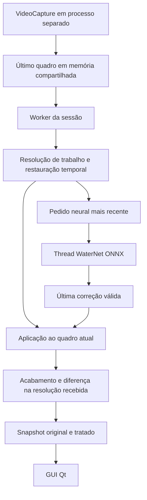

# Arquitetura da baseline 0.3.4

O código em `projeto/` é a autoridade sobre a implementação. Este mapa orienta
a leitura e destaca escolhas/limites que motivaram a conversa.

## Mapa de arquivos

| Arquivo | Responsabilidade |
|---|---|
| `app.py` | PySide6, controles, comparação, referência pressionada, status, PNG, QProcess da exportação |
| `engine.py` | Processo de captura, memória compartilhada, worker de apresentação/processamento, saúde da captura |
| `rov_ai.py` | Pré-processamento WaterNet, sessão ONNX, `estimate`, aplicação do delta |
| `live_ai.py` | Uma inferência em andamento e um pedido pendente substituível; transferência com movimento/validade |
| `temporal_restore.py` | Fusão de observações, supressão conservadora de pontos transitórios, luminância e limite de crominância |
| `processing.py` | Settings, caminho clássico, caminho IA síncrono, acabamento espacial |
| `export_video.py` | Leitura de todos os quadros, inferência por quadro e exportação MP4 temporária/atômica |
| `models/*.onnx` | Rede fixa rápida e detalhada, pesos incluídos |
| `test_*.py` | Testes recuperados das entregas, incluindo fixtures em `test_rov.py` |

## Fluxo ao vivo

O diagrama não significa que a captura seja controlada pela inferência.
Captura, worker da sessão, thread neural e GUI têm ritmos diferentes.

### Captura e vida da sessão

- Contexto multiprocessing `spawn`, para Windows. `mp.freeze_support()` no main.
- Buffer compartilhado máximo para 1920 × 1080 × 3 bytes, metadata com
  sequência, timestamp, dimensões processadas e dimensões recebidas.
- O formato é BGR `uint8`, contíguo. Fonte é ajustada por `fit_frame` sem ampliar.
- Capturadora: backend selecionável, pedidos de resolução/FPS/FourCC; o driver
  pode ignorar os pedidos. RTSP/HTTP usa FFmpeg e timeouts configurados.
- Arquivo: tenta cadência por timestamps; fallback por FPS plausível e repetição.
- Sem fila de quadros: o worker lê o mais recente e conta os pulados.
- Mensagens de captura têm fila limitada. Falha de driver fica em processo
  terminável; encerramento tenta join, terminate e kill.
- Uma fonte que continua entregando a mesma imagem congelada não é detectada
  pela simples chegada de timestamps novos.

### Saúde da captura versus idade do tratamento

A GUI atualiza por timer de 16 ms. Originalmente, apagava os dois painéis se
`now - packet.received > .75`, confundindo IA lenta com sinal perdido.
A correção 0.3.2a introduziu `Session.capture_health()` que lê o timestamp da
captura independentemente da inferência. A falta real de captura recente ainda
retira a imagem. Atraso de processamento com captura ativa mantém o último par
com aviso explícito de imagem atrasada e desabilita o PNG nesse estado.

A idade mostrada começa depois da entrega por `VideoCapture.read()`; não
inclui toda a câmera, buffers do driver, placa, cabo ou atraso do monitor.

## WaterNet e wrapper

- Modelo-base: réplica treinada por terceiros de `tnwei/waternet`.
- Rede ONNX opset 17; quatro entradas NCHW RGB float32 em [0,1]:
  `rgb`, `wb`, `he`, `gc`. Verificar os metadados ao modificar/exportar.
- `waternet_fast.onnx`: entrada 1 × 3 × 72 × 128.
- `waternet.onnx`: entrada 1 × 3 × 144 × 256.
- O modelo original foi treinado com resolução 256 × 256; as formas usadas
  aqui são exports para o pipeline local, não evidência de novo treinamento.
- Preserva proporção, aplica padding com borda replicada para a forma fixa.
- White balance por quantis com proteção contra divisões por zero e limites;
  gamma 0,7; CLAHE muito suave na luminância para compor as quatro entradas.
- A saída da rede não substitui diretamente o frame. Calcula
  `delta = clip(out*255 - rgb, -80, 80)`, suaviza com Gaussian 5 × 5 sigma 1,2,
  remove padding e devolve delta BGR + guia correspondente.
- `apply` multiplica pela intensidade na malha pequena, arredonda para int16,
  amplia o delta e soma por OpenCV com saturação para uint8. Isso reduziu
  alocações grandes em float. Quantização/interpolação podem alterar pixels
  em comparação com a implementação anterior; não alegar equivalência bit a bit.
- Preto total é preservado nos caminhos públicos de processamento.

### Execução ONNX

`intra_op_num_threads=2`, `ORT_SEQUENTIAL`, `enable_mem_pattern=False`.
Automático: tenta DmlExecutionProvider com `device_id`, seguido de CPU, quando
DirectML está disponível. CPU explícita força CPUExecutionProvider.

Não há seletor por nome/VRAM, autotuning, escolha do melhor adaptador ou
profiling de quais operadores efetivamente foram atribuídos à GPU.
Aumentar threads sem medir pode piorar competição com captura e GUI.
No modo fluido, carga/inferência ocorrem no worker neural; não há duas
chamadas concorrentes à mesma sessão DirectML nesse caminho.

## Vídeo fluido / live_ai.py

- Uma inferência em andamento; somente um pedido pendente, substituído pelo
  mais recente. Não acumular uma fila para “não perder quadros” ao vivo.
- A análise é solicitada no máximo nominal de 15/s. Não é uma meta garantida.
- Chave de sessão: qualidade, backend e índice de GPU. Epoch impede publicar
  resultados anteriores após reset/troca de cena/configuração.
- Corte grosso: diferença média >35 entre thumbnails 64 × 36.
- `Correction` contém epoch/key/seq/timestamp, delta, guia, ms e providers.
- Validade: `min(2, max(.9, analysis_ms/1000*3 + .15))` segundos.
  Atenuação nos últimos 0,2 s; a idade é a idade da correção, não um buffer
  intencionalmente atrasando a imagem inteira.
- Fluxo óptico backward Farneback em guia de largura até 128. Remapeia somente
  o delta de correção, mantendo a malha detalhada da rede.
- Verifica limites e erro de correspondência BGR; constrói confiança local.
  Rejeita se fração de confiança >0,5 for menor que 0,45 ou erro médio >32.
- Não transporta os pixels de uma imagem neural antiga para a imagem atual.

### Estados da imagem e fallback

- `applied`: correção neural correspondeu e foi aplicada com acabamento.
- `temporal`: somente restauração temporal/espacial atual; rede aguardando,
  correção expirada ou correspondência neural rejeitada. Isso é identificado
  no título e nas métricas. Não contabilizar como quadro neural corrigido.
- `waiting`, `changed`, `expired`: original quando restauração temporal está
  zerada e a correção neural não pode ser usada.
- `black`: quadro preto original.
- Erro real da IA: original preservado, aviso de filtro indisponível.

Há transições de aparência possíveis entre neural e temporal. Isto é um ponto
aberto importante: a imagem pode mudar de cor mesmo sem ficar preta.

## Restauração temporal 0.3.4

### Resoluções e preservação da entrada

- `working_frame`: limite padrão 640 × 360, sem ampliar fontes menores.
- `TemporalRestorer.clean`: trabalho interno limitado a 480 × 270.
- `lift_change`: calcula diferença signed entre trabalho/restaurado, amplia
  a diferença e soma ao frame recebido. Saída mantém dimensões e detalhes
  originais que não tenham sido alterados pela diferença.
- Não chamar isso de restauração neural de todos os detalhes em Full HD.

### Fusão de quadros reais

- Histórico: quadro anterior bruto e uma observação mais antiga alinhada;
  não é uma mistura recursiva de profundidade ilimitada.
- Guia em cinza de largura até 192, suavizada com Gaussian 5 × 5 sigma 1,2.
- Reinicia em ausência de histórico, formato diferente, dt <=0 ou >0,25 s,
  ou mudança média de guia >28.
- Farneback backward e forward; consistência <1,25 pixel na guia,
  erro fotométrico <18 e validade de borda.
- Mistura normal somente onde erro máximo por canal <=12, peso até
  `0.4 * amount`.
- Ponto transitório: top-hat 5 × 5 >14, luminância atual acima da referência
  >16, acordo de duas observações anteriores <=9 por canal, correspondência válida.
- Seleção de componentes até 36 pixels e até 9 × 9 na resolução de trabalho.
  Peso de atenuação `0.8 * amount`; redução máxima da referência limitada a 50.
- Faixas superior 12% e inferior 10% ficam fora da mistura temporal, para
  não misturar telemetria e timestamps. Não é um detector geral de overlays.
- Pequenos objetos reais luminosos podem ser confundidos com partículas.
  Grandes partículas não são removidas universalmente.

### Luminância e cor

- `clarify`: percentis 2/98 numa guia; preserva imagem se amplitude <24.
  Estima níveis limitados e suaviza-os com constante aproximada de 0,6 s.
  Ganho de luminância limitado a 1,8 e alteração a ±32*amount.
- `limit_added_chroma`: limita saturação adicionada em relação à fonte
  em YCrCb (norma L1 em torno de 128, tolerância +10), proporcional ao
  controle de restauração. Pode limitar cores legítimas também.

Essas etapas são algoritmos convencionais, não pesos novos de uma IA.

## Acabamento espacial

`finish_ai`: bilateral 5 × 5 e mistura de ruído; controle opcional de pontos
claros; nitidez em luminância com deadband 2 e limite de alteração ±10*sharp.

Pontos claros espaciais: diferença de mediana 3 × 3 e abertura 3 × 3,
limiar >20, componentes até 6 pixels/4 × 4, correção limitada a 40*specks.
Zero desativa o controle. Em 0.3.4 é recomendado começar em zero para avaliar
o módulo temporal sem pagar outro custo ou atenuar detalhes desnecessariamente.

## Modo clássico protegido

Gray-world limitado a 0,85–1,15, CLAHE limitado a 2, mínimo de transmissão
0,40 na remoção de véu. Estimativa UDCP azul/verde e filtro guiado.
Dehaze altera luminância preservando crominância original em YCrCb.
Esses limites vieram de uma regressão visual com paredes vermelhas/ruído na webcam.
Não aplicar essa correção clássica à rede sob a suposição de que a reclamação
da webcam dizia respeito à IA: o usuário confirmou que gostou da IA no vídeo.

## Exportação

- QProcess separado; GUI continua respondendo e desconecta a captura durante exportação.
- Processa todos os quadros decodificados com `Enhancer` síncrono, incluindo
  restauração temporal com dt da taxa da fonte; não usa o cache neural ao vivo.
- MP4 `mp4v`, fonte com FPS finito entre 1 e 240, sem áudio; dimensões pares.
- Arquivo temporário `destino.rov-part.mp4`, seguido de replace após concluir.
- Rejeita fonte igual ao destino, temporário já existente, vídeo vazio,
  formato inválido e contagem incompleta conhecida. Cancelamento mata o processo.
- Não garante preservação de VFR/áudio/metadados. PNG usa o par recente.

## Investigação prioritária de desempenho

Adicionar medição por estágio no Windows: leitura/cópia do buffer, resize,
clean/flow, transfer, limit_added_chroma, clarify, bilateral, componentes,
sharp, lift_change, QImage.copy, escala/pintura e espera por locks/GIL.
Os campos `temporal_ms`, `transfer_ms`, `finish_ms` já ajudam, mas não cobrem
toda a experiência de exibição. Verificar os campos ausentes nos estados
iniciais/fallback antes de agregar estatísticas.

Manter benchmarks separados de testes concorrentes, exportações, compilação
e outros modelos. Medir aquecimento, p50/p95, cadência e qualidade/estado;
“30 FPS” exibindo original ou só temporal não é 30 inferências detalhadas/s.
