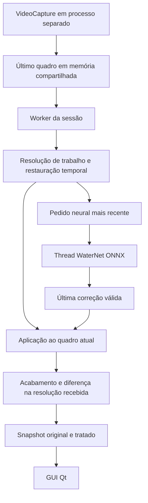

# CONTEXTO COMPLETO CONSOLIDADO — ROV LIVE / CODEX

Este arquivo reúne os documentos técnicos do pacote, para leitura única.
O código, modelos e evidências estão nas pastas do ZIP.


---

Documento de origem: `LEIA_PRIMEIRO_CONTEXTO.md`

# ROV Live — transferência de contexto para o Codex

Atualizado em 29/10/2026. Projeto da Underwater/Underocean para melhorar a
visualização de câmeras de ROV, com funcionamento local e distribuição offline.

## Como usar este pacote

1. Abra a pasta deste pacote no Codex.
2. Leia este documento, `ARQUITETURA_E_ALGORITMOS.md`, `HISTORICO_E_DECISOES.md`
   e `VALIDACAO_E_GARGALOS.md`.
3. O código completo reconstruído da última entrega está em `projeto/`.
   Inclui os dois modelos ONNX, dependências, interface e testes.
4. Veja `evidencias/ULTIMO_RESULTADO_APROVADO.png` antes de mudar o tratamento.
5. Use `PROMPT_PARA_CODEX.txt` como primeira instrução para continuar.
6. O vídeo real completo `1029.mp4` precisa ser adicionado separadamente.
   Consulte `ARQUIVOS_E_REFERENCIAS.md`. Há exemplos curtos incluídos.

Este é um contexto técnico consolidado do histórico acessível e dos arquivos
recuperados, não uma exportação oficial ou transcrição bruta integral do chat.
Falas relevantes foram preservadas e as decisões foram documentadas.
Não contém instruções internas da plataforma nem assuntos de outros projetos.
O documento de transferência original está em `historico/` e descreve uma
pausa antiga da versão 0.2; seu status não substitui o estado atual abaixo.

## Estado atual e prioridade principal

**A versão mais recente entregue é a 0.3.4 experimental. O usuário aprovou a
melhoria visual, mas a fluidez no computador dele continua insuficiente.**

Último feedback: **“ta muito melhor”**, com print da estrutura submersa,
cabo claro e elemento alongado enferrujado no centro. O painel tratado deixa
os contornos mais perceptíveis. Há sombras mais fechadas e dominante roxa
residual em algumas regiões; não supor fidelidade de cor comprovada.

Status do último print, no computador do usuário:

| Medida | Valor |
|---|---:|
| Vídeo | 6,5 FPS |
| Aplicação | 116,4 ms |
| Análises da IA | 7,1 análises/s |
| Tempo indicado da IA | 77 ms |
| Idade da correção | 153 ms |
| Estado | Correção aplicada |

O recorte não mostra o número da versão instalada: confirmar no aplicativo.
Esses dados são de um instante e não uma medição controlada. Ainda assim,
mostram que **o gargalo não se resume à inferência neural**. Transferência,
restauração temporal, acabamento, cópias, concorrência, captura e renderização
precisam ser medidos no Windows. O usuário observou CPU e GPU totais abaixo
de 40%; isso não prova ausência de gargalo, nem identifica o adaptador usado.

**Preservar a qualidade aprovada. Não resolver apenas escolhendo a análise
Rápida: o usuário testou e considerou a imagem insuficiente.**

## O que o usuário quer

- Imagem submarina mais nítida e útil, com menos véu, granulação e partículas.
- Vídeo ao vivo com pouca espera e movimento fluido.
- Evolução real do software e da IA, com entregas utilizáveis, não só planos.
- Aproximar o resultado das demonstrações de Orphiecam/SeaVision; deseja
  competitividade, mas não houve demonstração de equivalência ou superioridade.
- Inspiração declarada em DLSS 5: análise contínua e reconstrução percebida.
  Isso é uma referência de experiência, não uma especificação técnica pronta.
- Aplicativo Windows que funcione sem internet no simulador, levado em pendrive.
- Deseja agora programar mais a fundo no Codex e pediu esta transferência.

Não foi pedido controle do ROV, alteração de firmware ou navegação autônoma.

## Hardware e implantação conhecidos

- Windows no computador de uso; o modelo exato de CPU não foi confirmado.
- Na máquina atual o usuário informou gráficos integrados.
- Outros computadores para testes teriam GPUs com 8 GB de VRAM. Não sabemos
  fabricante/modelo, capacidade real de execução nem drivers instalados.
- Não inferir NVIDIA, CUDA, AMD ou Intel a partir de “8 GB”.
- O simulador está sem internet; pacote deve incluir runtime, dependências e
  modelos. Arquivo local/câmera local não devem exigir rede.
- Câmera IP exige conectividade local com a câmera; isso difere de internet.
- Drivers da capturadora e da GPU precisam existir no Windows. Não foram
  testados fisicamente pelo assistente.

## O que a “IA” atual realmente é

1. Uma réplica pré-treinada de **WaterNet**, proveniente de `tnwei/waternet`,
   exportada para ONNX, usada para estimar uma correção em resolução reduzida.
2. Um wrapper próprio que limita e suaviza a correção e a transfere aos pixels
   de entrada, preservando detalhes da imagem original em vez de substituir
   toda a imagem pela saída reduzida da rede.
3. Algoritmos tradicionais de acabamento, alinhamento e fusão temporal.

**Não houve treinamento de pesos próprios da Underwater.** Não há modelo
generativo que reconstrua livremente o ambiente oculto, super-resolução neural
de vídeo implementada, DLSS integrado, malha 3D ou validação de inspeção.
A palavra “restauração” no produto identifica esse processamento híbrido.
Não converter uma hipótese de detalhe em evidência de geometria real.

## Funções existentes

- Captura por dispositivo/câmera, arquivo e URL RTSP/HTTP.
- Comparação original/tratado, vista individual, tela cheia e referência
  original pressionada; PNG de comparação de quadro recente.
- Modo clássico protegido e modo IA.
- IA Rápida 128 × 72 e Detalhada 256 × 144.
- Execução Automático (DirectML quando disponível, com CPU) ou CPU explícita;
  índice de GPU numérico. “Automático” não significa seleção da GPU mais rápida.
- Intensidade, redução de ruído, nitidez, suavização de pontos claros e
  restauração temporal. Controles clássicos ficam desativados no modo IA.
- Modo de vídeo fluido que desacopla análise neural da apresentação.
- Exportação MP4 de todos os quadros decodificados, sem áudio, com taxa
  constante plausível da fonte. A exportação pode ser muito mais lenta que o vídeo.
- Captura isolada em processo, reconexão manual e descarte de quadros em
  sobrecarga; sem fila longa acumulando atraso.

## Defaults que precisam ser distinguidos

Na GUI 0.3.4: IA, Detalhada, Automático, índice 0, vídeo fluido ligado,
intensidade 80%, ruído 30%, nitidez 15%, pontos claros 0%, restauração 35%.

Na dataclass `Settings`, por compatibilidade: `mode='classic'`, `quality='fast'`,
`ai_realtime=False`, `ai_restore=0`, `ai_noise=0`, `ai_sharp=0`,
`ai_specks=0`, intensidade 1. A GUI monta seus próprios valores.
Não confundir os defaults da API/CLI com os mostrados ao usuário.

Intensidade zero ou melhoria desligada faz bypass. Acima de zero, intensidade
muda a força da correção; não reduz proporcionalmente o custo da inferência.
O usuário encontrou 30,1 FPS / 0,6 ms em intensidade zero — isso era o bypass.

## Abertura e executável

O pacote portátil original continha Python 3.12.10 embutido x64 e dependências.
O primeiro launcher Go chamava `pythonw.exe`, alterava variáveis Qt e usava
`app/` como diretório de trabalho. No PC do usuário ficou só o processo do
launcher, sem janela. O log tinha apenas o cabeçalho; a causa exata não foi isolada.

Funcionou no computador do usuário, partindo da pasta do portátil:

```bat
runtime\python.exe -u app\app.py
```

Depois foi compilado um novo `ROV_Live_IA.exe` que chama
`cmd.exe /d /c INICIAR_PORTATIL.cmd` na pasta correta, com console visível.
Fonte Go, licença e binário estão em `iniciador_windows/`.
Esse launcher foi compilado e inspecionado como PE Windows x64, mas sua abertura
não teve confirmação explícita posterior do usuário. O uso por CMD foi confirmado.
Não afirmar que a causa era comprovadamente `pythonw.exe` ou uma DLL específica.

O launcher **não é o aplicativo inteiro em um único arquivo**. Precisa das
pastas `app/` e `runtime/`, mantendo o pacote portátil completo junto dele.
Este ZIP de transferência contém o projeto para desenvolvimento e o iniciador,
mas **não inclui o runtime Windows de centenas de megabytes**. Há link para
o portátil original em `ARQUIVOS_E_REFERENCIAS.md`.

## Como foi montado o código deste pacote

- Base completa: `ROV_Live_IA_v0.3.2.zip`, recuperada dos arquivos da conversa.
- Aplicados os sete módulos de `ROV_Live_IA_Atualizacao_0.3.4.zip`.
- Substituídos/adicionados os testes encontrados na atualização 0.3.4.
- Preservados modelos ONNX, requisitos, instaladores e licenças da base.
- Documentos antigos da base movidos a `projeto/documentacao_anterior/`.
- Mantidas as instruções e a validação da entrega 0.3.4 em `historico/`.

Não é uma captura do disco do usuário: pode haver alterações locais feitas por
ele que não aparecem nos arquivos entregues. O código não foi reescrito nesta
transferência. Os benchmarks/testes relatados pertencem às entregas anteriores;
neste empacotamento foram conferidos integridade, sintaxe e correspondência
dos módulos recuperados, sem alegar nova validação operacional.

## Próxima sessão no Codex

1. Reproduzir o estado atual com vídeo e parâmetros registrados.
2. Confirmar versão instalada, resolução efetivamente recebida e executores
   reais do ONNX no PC de destino. A lista de providers não prova que todas
   as operações rodem na GPU.
3. Instrumentar etapas e medir p50/p95, FPS e idade da correção. Separar tempo
   de filtro do custo da GUI e da latência total câmera-monitor.
4. Otimizar primeiro o caminho de aplicação, acabamento, fusão e renderização,
   comparando com a imagem aprovada; não apenas trocar para 128 × 72.
5. Avaliar qualidade temporal: rastros, oclusão, cabos finos, pequenas partículas,
   mudanças de luz e alternância entre neural e somente temporal.
6. Para modelos novos, comparar com esta baseline e documentar pesos,
   licença, hardware, velocidade e fidelidade. Não assumir que modelo mais
   pesado ou mais “generativo” será melhor para operação de ROV.
7. Validar Windows/DirectML/captura e distribuição offline antes de prometer
   uma versão pronta para o simulador.

O alvo desejado é vídeo útil e próximo de 25–30 FPS quando o hardware permitir,
com atraso controlado. Isso é uma meta de desenvolvimento, não resultado
confirmado no computador do usuário.


---

Documento de origem: `ARQUITETURA_E_ALGORITMOS.md`

# Arquitetura da baseline 0.3.4

O código em `projeto/` é a autoridade sobre a implementação. Este mapa orienta
a leitura e destaca escolhas/limites que motivaram a conversa.

## Mapa de arquivos

| Arquivo | Responsabilidade |
|---|---|
| `app.py` | PySide6, controles, comparação, referência pressionada, status, PNG, QProcess da exportação |
| `engine.py` | Processo de captura, memória compartilhada, worker de apresentação/processamento, saúde da captura |
| `rov_ai.py` | Pré-processamento WaterNet, sessão ONNX, `estimate`, aplicação do delta |
| `live_ai.py` | Uma inferência em andamento e um pedido pendente substituível; transferência com movimento/validade |
| `temporal_restore.py` | Fusão de observações, supressão conservadora de pontos transitórios, luminância e limite de crominância |
| `processing.py` | Settings, caminho clássico, caminho IA síncrono, acabamento espacial |
| `export_video.py` | Leitura de todos os quadros, inferência por quadro e exportação MP4 temporária/atômica |
| `models/*.onnx` | Rede fixa rápida e detalhada, pesos incluídos |
| `test_*.py` | Testes recuperados das entregas, incluindo fixtures em `test_rov.py` |

## Fluxo ao vivo



O diagrama não significa que a captura seja controlada pela inferência.
Captura, worker da sessão, thread neural e GUI têm ritmos diferentes.

### Captura e vida da sessão

- Contexto multiprocessing `spawn`, para Windows. `mp.freeze_support()` no main.
- Buffer compartilhado máximo para 1920 × 1080 × 3 bytes, metadata com
  sequência, timestamp, dimensões processadas e dimensões recebidas.
- O formato é BGR `uint8`, contíguo. Fonte é ajustada por `fit_frame` sem ampliar.
- Capturadora: backend selecionável, pedidos de resolução/FPS/FourCC; o driver
  pode ignorar os pedidos. RTSP/HTTP usa FFmpeg e timeouts configurados.
- Arquivo: tenta cadência por timestamps; fallback por FPS plausível e repetição.
- Sem fila de quadros: o worker lê o mais recente e conta os pulados.
- Mensagens de captura têm fila limitada. Falha de driver fica em processo
  terminável; encerramento tenta join, terminate e kill.
- Uma fonte que continua entregando a mesma imagem congelada não é detectada
  pela simples chegada de timestamps novos.

### Saúde da captura versus idade do tratamento

A GUI atualiza por timer de 16 ms. Originalmente, apagava os dois painéis se
`now - packet.received > .75`, confundindo IA lenta com sinal perdido.
A correção 0.3.2a introduziu `Session.capture_health()` que lê o timestamp da
captura independentemente da inferência. A falta real de captura recente ainda
retira a imagem. Atraso de processamento com captura ativa mantém o último par
com aviso explícito de imagem atrasada e desabilita o PNG nesse estado.

A idade mostrada começa depois da entrega por `VideoCapture.read()`; não
inclui toda a câmera, buffers do driver, placa, cabo ou atraso do monitor.

## WaterNet e wrapper

- Modelo-base: réplica treinada por terceiros de `tnwei/waternet`.
- Rede ONNX opset 17; quatro entradas NCHW RGB float32 em [0,1]:
  `rgb`, `wb`, `he`, `gc`. Verificar os metadados ao modificar/exportar.
- `waternet_fast.onnx`: entrada 1 × 3 × 72 × 128.
- `waternet.onnx`: entrada 1 × 3 × 144 × 256.
- O modelo original foi treinado com resolução 256 × 256; as formas usadas
  aqui são exports para o pipeline local, não evidência de novo treinamento.
- Preserva proporção, aplica padding com borda replicada para a forma fixa.
- White balance por quantis com proteção contra divisões por zero e limites;
  gamma 0,7; CLAHE muito suave na luminância para compor as quatro entradas.
- A saída da rede não substitui diretamente o frame. Calcula
  `delta = clip(out*255 - rgb, -80, 80)`, suaviza com Gaussian 5 × 5 sigma 1,2,
  remove padding e devolve delta BGR + guia correspondente.
- `apply` multiplica pela intensidade na malha pequena, arredonda para int16,
  amplia o delta e soma por OpenCV com saturação para uint8. Isso reduziu
  alocações grandes em float. Quantização/interpolação podem alterar pixels
  em comparação com a implementação anterior; não alegar equivalência bit a bit.
- Preto total é preservado nos caminhos públicos de processamento.

### Execução ONNX

`intra_op_num_threads=2`, `ORT_SEQUENTIAL`, `enable_mem_pattern=False`.
Automático: tenta DmlExecutionProvider com `device_id`, seguido de CPU, quando
DirectML está disponível. CPU explícita força CPUExecutionProvider.

Não há seletor por nome/VRAM, autotuning, escolha do melhor adaptador ou
profiling de quais operadores efetivamente foram atribuídos à GPU.
Aumentar threads sem medir pode piorar competição com captura e GUI.
No modo fluido, carga/inferência ocorrem no worker neural; não há duas
chamadas concorrentes à mesma sessão DirectML nesse caminho.

## Vídeo fluido / live_ai.py

- Uma inferência em andamento; somente um pedido pendente, substituído pelo
  mais recente. Não acumular uma fila para “não perder quadros” ao vivo.
- A análise é solicitada no máximo nominal de 15/s. Não é uma meta garantida.
- Chave de sessão: qualidade, backend e índice de GPU. Epoch impede publicar
  resultados anteriores após reset/troca de cena/configuração.
- Corte grosso: diferença média >35 entre thumbnails 64 × 36.
- `Correction` contém epoch/key/seq/timestamp, delta, guia, ms e providers.
- Validade: `min(2, max(.9, analysis_ms/1000*3 + .15))` segundos.
  Atenuação nos últimos 0,2 s; a idade é a idade da correção, não um buffer
  intencionalmente atrasando a imagem inteira.
- Fluxo óptico backward Farneback em guia de largura até 128. Remapeia somente
  o delta de correção, mantendo a malha detalhada da rede.
- Verifica limites e erro de correspondência BGR; constrói confiança local.
  Rejeita se fração de confiança >0,5 for menor que 0,45 ou erro médio >32.
- Não transporta os pixels de uma imagem neural antiga para a imagem atual.

### Estados da imagem e fallback

- `applied`: correção neural correspondeu e foi aplicada com acabamento.
- `temporal`: somente restauração temporal/espacial atual; rede aguardando,
  correção expirada ou correspondência neural rejeitada. Isso é identificado
  no título e nas métricas. Não contabilizar como quadro neural corrigido.
- `waiting`, `changed`, `expired`: original quando restauração temporal está
  zerada e a correção neural não pode ser usada.
- `black`: quadro preto original.
- Erro real da IA: original preservado, aviso de filtro indisponível.

Há transições de aparência possíveis entre neural e temporal. Isto é um ponto
aberto importante: a imagem pode mudar de cor mesmo sem ficar preta.

## Restauração temporal 0.3.4

### Resoluções e preservação da entrada

- `working_frame`: limite padrão 640 × 360, sem ampliar fontes menores.
- `TemporalRestorer.clean`: trabalho interno limitado a 480 × 270.
- `lift_change`: calcula diferença signed entre trabalho/restaurado, amplia
  a diferença e soma ao frame recebido. Saída mantém dimensões e detalhes
  originais que não tenham sido alterados pela diferença.
- Não chamar isso de restauração neural de todos os detalhes em Full HD.

### Fusão de quadros reais

- Histórico: quadro anterior bruto e uma observação mais antiga alinhada;
  não é uma mistura recursiva de profundidade ilimitada.
- Guia em cinza de largura até 192, suavizada com Gaussian 5 × 5 sigma 1,2.
- Reinicia em ausência de histórico, formato diferente, dt <=0 ou >0,25 s,
  ou mudança média de guia >28.
- Farneback backward e forward; consistência <1,25 pixel na guia,
  erro fotométrico <18 e validade de borda.
- Mistura normal somente onde erro máximo por canal <=12, peso até
  `0.4 * amount`.
- Ponto transitório: top-hat 5 × 5 >14, luminância atual acima da referência
  >16, acordo de duas observações anteriores <=9 por canal, correspondência válida.
- Seleção de componentes até 36 pixels e até 9 × 9 na resolução de trabalho.
  Peso de atenuação `0.8 * amount`; redução máxima da referência limitada a 50.
- Faixas superior 12% e inferior 10% ficam fora da mistura temporal, para
  não misturar telemetria e timestamps. Não é um detector geral de overlays.
- Pequenos objetos reais luminosos podem ser confundidos com partículas.
  Grandes partículas não são removidas universalmente.

### Luminância e cor

- `clarify`: percentis 2/98 numa guia; preserva imagem se amplitude <24.
  Estima níveis limitados e suaviza-os com constante aproximada de 0,6 s.
  Ganho de luminância limitado a 1,8 e alteração a ±32*amount.
- `limit_added_chroma`: limita saturação adicionada em relação à fonte
  em YCrCb (norma L1 em torno de 128, tolerância +10), proporcional ao
  controle de restauração. Pode limitar cores legítimas também.

Essas etapas são algoritmos convencionais, não pesos novos de uma IA.

## Acabamento espacial

`finish_ai`: bilateral 5 × 5 e mistura de ruído; controle opcional de pontos
claros; nitidez em luminância com deadband 2 e limite de alteração ±10*sharp.

Pontos claros espaciais: diferença de mediana 3 × 3 e abertura 3 × 3,
limiar >20, componentes até 6 pixels/4 × 4, correção limitada a 40*specks.
Zero desativa o controle. Em 0.3.4 é recomendado começar em zero para avaliar
o módulo temporal sem pagar outro custo ou atenuar detalhes desnecessariamente.

## Modo clássico protegido

Gray-world limitado a 0,85–1,15, CLAHE limitado a 2, mínimo de transmissão
0,40 na remoção de véu. Estimativa UDCP azul/verde e filtro guiado.
Dehaze altera luminância preservando crominância original em YCrCb.
Esses limites vieram de uma regressão visual com paredes vermelhas/ruído na webcam.
Não aplicar essa correção clássica à rede sob a suposição de que a reclamação
da webcam dizia respeito à IA: o usuário confirmou que gostou da IA no vídeo.

## Exportação

- QProcess separado; GUI continua respondendo e desconecta a captura durante exportação.
- Processa todos os quadros decodificados com `Enhancer` síncrono, incluindo
  restauração temporal com dt da taxa da fonte; não usa o cache neural ao vivo.
- MP4 `mp4v`, fonte com FPS finito entre 1 e 240, sem áudio; dimensões pares.
- Arquivo temporário `destino.rov-part.mp4`, seguido de replace após concluir.
- Rejeita fonte igual ao destino, temporário já existente, vídeo vazio,
  formato inválido e contagem incompleta conhecida. Cancelamento mata o processo.
- Não garante preservação de VFR/áudio/metadados. PNG usa o par recente.

## Investigação prioritária de desempenho

Adicionar medição por estágio no Windows: leitura/cópia do buffer, resize,
clean/flow, transfer, limit_added_chroma, clarify, bilateral, componentes,
sharp, lift_change, QImage.copy, escala/pintura e espera por locks/GIL.
Os campos `temporal_ms`, `transfer_ms`, `finish_ms` já ajudam, mas não cobrem
toda a experiência de exibição. Verificar os campos ausentes nos estados
iniciais/fallback antes de agregar estatísticas.

Manter benchmarks separados de testes concorrentes, exportações, compilação
e outros modelos. Medir aquecimento, p50/p95, cadência e qualidade/estado;
“30 FPS” exibindo original ou só temporal não é 30 inferências detalhadas/s.


---

Documento de origem: `HISTORICO_E_DECISOES.md`

# Histórico e decisões da conversa

Esta é uma consolidação cronológica, não uma transcrição literal completa.
Os pedidos destacados entre aspas são falas acessíveis do usuário. A fase anterior
à retomada está documentada integralmente no contexto histórico original incluído.

## 1. Produto inicial e retomada da 0.2

O usuário começou esta etapa pedindo: “Leia LEIA_PRIMEIRO_CONTEXTO.md dentro do ZIP.
Este é o projeto ROV Live da Underwater. Confira o estado da atualização 0.2 e
me explique brevemente onde paramos antes de continuar.” Depois autorizou:
“pode continuar por mim?”.

A versão 0.1 já abria no Windows. A 0.2 era inicialmente um checkpoint pausado,
com dehaze clássico reforçado e otimização SIMD ainda sem validação final.
Após a retomada foram concluídas verificações e entregue a 0.2 clássica.
O usuário perguntou sobre substituir arquivos da pasta 0.1. Atualização deveria
preservar uma instalação funcional, sem pedir reinstalações desnecessárias.

O objetivo foi reforçado: “o nosso desejo é fazer uma a IA analisar fazer essas
alterações, parecido como o DLSS5 funciona em alguns jogos”. A inspiração não
significava que a implementação já usava aprendizado ou tecnologia DLSS.

O usuário informou: “neste computador é integrada, porém nos computadores em
que queremos fazer os testes a placa é de 8gb de ram (o modelo não vou saber te
informar precisamente”. A interpretação técnica adotada foi GPU com 8 GB de
VRAM nos futuros testes, com fabricante e modelo desconhecidos.

Expressou urgência e inspiração em Orphiecam: queria avançar rapidamente e que
o sistema de visualização fosse melhor. Pediu: “procure um ou se for mais
inteligente, CRIE um especifico para isso”. Não tratar esse desejo competitivo
como prova de desempenho alcançado.

## 2. Da correção clássica à IA real

O usuário perguntou o que o ZIP fazia e insistiu: “eu quero que vc ja crie a IA
que irá fazer essa tarefa do video. eu quero que VOCÊ DESENVOLVA ISSO e me
entregue essa IA que irá fazer toda esse processo”.

Foram avaliadas redes pré-treinadas, não treinado um modelo novo:

### FUnIE-GAN — ensaio rejeitado

- Repositório `xahidbuffon/FUnIE-GAN`, commit registrado
  `8f934c834c94e007b00866186b9ee624dc2b7b69`.
- Pesos generator de aproximadamente 28 MB; export ONNX comparado com PyTorch,
  diferença máxima relatada ~9,53e-6; inferência CPU ~60 ms em 256 quadrado
  num ensaio histórico, não no PC do usuário.
- Melhorou um exemplo público de peixes, mas na cena da mina gerou forte
  vermelho/magenta e deformou sobreposições. **Não foi adotado no app.**
- A pasta LAB da pesquisa não era um produto funcional entregue.

### WaterNet — modelo adotado

- Réplica de terceiros `tnwei/waternet`, commit registrado
  `2091896881fe0dfa5fb96007f29021a6067259cb`.
- Pesos originais de cerca de 4,37 MB. Export opset 17; diferença ONNX/PyTorch
  máxima relatada ~5,96e-7 para o export detalhado.
- Substituir diretamente a imagem pelo resultado reduzido deixava a cena
  borrada e às vezes azul/roxa. Foi criado um wrapper para transferir correção
  suave/limitada ao original e preservar seus detalhes.
- Primeiro houve prova experimental CLI para imagens; depois a integração
  completa em vídeo na 0.3, conforme a necessidade do usuário.
- Não houve treinamento proprietário. Código MIT do upstream foi incluído.

## 3. Entrega 0.3

App PySide6 com WaterNet ONNX, qualidade rápida/detalhada, seleção automática
DirectML/CPU e índice de adaptador. Captura em processo e inferência em worker,
com original comparável e exportação MP4 sem áudio em QProcess.

Foram relatados 21 testes. Exemplo histórico de exportação: 90 quadros de
3 segundos em ~12,3 s de CPU; não era processamento em tempo real.

## 4. Regressão clássica e 0.3.1

O usuário mostrou uma webcam de sala com paredes muito vermelhas, ruído e
configuração clássica agressiva. Disse que água turva estava estranha nos testes.
O print tinha Clássico, perfil que não refletia os controles manuais,
intensidade 95%, exposição -0,9, cor 85%, contraste 3 e névoa 100%.

Correções clássicas: limites mais conservadores de ganho, contraste e
transmissão; reconstrução só de luminância, preservando crominância; perfil
Personalizado para ajustes manuais. 23 testes relatados.

O usuário esclareceu: “mas ficou bemnmm melhor em relação a agua turva no video”,
e depois respondeu **“IA”** ao identificar qual tratamento havia melhorado.
Essa distinção importa: não desfazer a IA aprovada para corrigir um artefato
que era do modo clássico da webcam.

## 5. Acabamento 0.3.2 e distribuição offline

Pedido: “se conseguir cada vez mais aumentar a nitidez e reduzir a ‘poeira’ na
imagem tratada pela IA vai ser perfeito. no momento ja está incrivelmente prestatvo”.

Foram acrescentados bilateral e nitidez limitada após a rede; defaults da GUI
ruído 30%, nitidez 15%. Não houve treino novo. 27 testes relatados.
Exemplo histórico: exportação de 90 quadros em ~12,1 s de CPU.

O usuário perguntou se bastava abrir o arquivo em outro PC e explicou:
“precisava que fosse um executavel pq o computador que usamos no simulador
não utiliza internet e nesse momento a gente iria passar tudo no pendrive”.

Foi montado portátil Windows x64 (~208,2 MB ZIP, ~516,9 MB extraído), contendo:
Python 3.12.10 embutido, numpy 2.2.4, OpenCV headless 4.11.0.86,
ONNX Runtime DirectML 1.23.0, PySide6 Essentials/shiboken 6.8.3 e dependências,
dois modelos, plugins Qt e launcher Go. Um VC_redist.x64.exe offline foi
incluído como suporte, sem execução automática. Os fontes não precisam de
todas essas dependências vendorizadas para desenvolvimento.

O usuário perguntou se todas as funções funcionariam. Foi esclarecido que as
funções estavam incluídas, mas não havia teste real do portátil no Windows,
GPU/capturadora não estavam verificadas e a exportação não mantinha áudio.

## 6. Lentidão com IA e intensidade zero

O usuário relatou travamento ao ativar a IA, apesar de CPU/GPU abaixo de 40%.
Primeiro status enviado: 5,1 FPS, filtro 206 ms, idade 235 ms e 78.030 pulados.
Depois: 6,9 FPS, filtro 152,5 ms, idade 187 ms e 26.901 pulados.
Contadores são acumulados e não medem taxa de perda sem janela de tempo.

O usuário disse: “é que a rapida não ficou tão utilizavel quanto eu preciso”.
Assim, análise detalhada foi tratada como requisito de qualidade.
Outro print confirmou 256 × 144, Automático, índice 0, ruído 30%, nitidez 15%.
O provider real não chegou a ser confirmado por esse print.

O usuário atribuiu o travamento à intensidade e mostrou 30,1 FPS / 0,6 ms
em intensidade zero. Conferência do código mostrou bypass total em zero;
qualquer intensidade positiva ativa o tratamento. Não é a multiplicação
do slider que explica o custo da rede.

Foi sugerida a comparação CPU/Automático, mas não há um resultado controlado
documentado dessa comparação no PC de destino. Evitar concluir qual é melhor.

## 7. Problema do primeiro executável

Ao clicar no EXE, aparecia somente um processo ROV_Live_IA de ~1,7 MB, sem GUI.
Log enviado `20261028_155106.160200.log`: apenas cabeçalho de início, sem traceback.

Foi solicitado abrir `runtime\python.exe -u app\app.py`. A primeira tentativa
foi em C:\Windows\System32 e falhou por caminho inexistente. O usuário foi
orientado a abrir CMD pela barra de endereço da pasta do portátil.
Respondeu: **“abriu o app”**. Depois reafirmou que o CMD funcionava e o EXE não.

Foi compilado novo launcher que usa o CMD funcional com console visível.
Não houve confirmação explícita de abertura pelo novo EXE. Não afirmar que
os prints posteriores comprovam isso, pois podem ter vindo do CMD.

## 8. Piscar / tela preta e correção 0.3.2a

O usuário mostrou “SEM QUADRO RECENTE / Confira o sinal e reconecte”.
Diagnóstico no código: timeout de .75 s usava o timestamp do quadro tratado,
não a saúde independente da captura. IA lenta podia apagar os dois painéis.

Patch: `capture_health`, manutenção do último par com aviso quando o atraso
é de processamento, remoção da imagem quando captura realmente cessa,
carregamento inicial da IA não encerrando captura ativa por engano.
31 testes relatados. Patch não pretendia acelerar a inferência.

## 9. Arquitetura fluida 0.3.3

Pedido: “pode tentar melhorar a IA e evitar esse gargalo, e no caso melhorando
a IA eu quero que se aproxime ao maximo daquele video e ter uma visão nitida do
ambiente submarino”.

Implementado worker neural separado, mailbox latest-only, correção com guia
de movimento/confiança, validade limitada e identificação de fallback.
Modelo detalhado mantido. Acrescentado controle opcional de pontos claros.
45 testes relatados, incluindo três do atualizador.

Um ensaio Linux/CPU com recorte ampliado a 540p mostrou ~1,5 FPS por quadro
versus ~30 FPS de vídeo no modo fluido. **Isso não significou 30 inferências/s**,
nem garantia de Windows. Foram dados históricos de outro trecho/ambiente.

## 10. Novo vídeo real e 0.3.4

O usuário mostrou água turva/estruturas e perguntou: “seria possivel usar nossa
IA para reconstruir a imagem e assim melhorar a visualização”. O status
mostrava 4,9 FPS, aplicação 248,1 ms, IA 5,7 análises/s e 79 ms, correção 221 ms.
Era evidência de custo grande fora da inferência.

Foi pedido vídeo original e o usuário anexou **1029.mp4**:
1920 × 1080, 30 FPS, 8.872 quadros, 234.628.760 bytes, ~4min56s.
Mostra estruturas submersas, mudança de orientação, regiões turvas e muitos
pontos/debris em outros trechos; tem depth/temp/timestamp do FIFISH.

Implementada restauração temporal tradicional combinada à WaterNet, trabalho
limitado, transferência da diferença ao Full HD, contraste de luminância e
limite de crominância adicionada. Ajuste padrão da GUI: restauração 35%.

Foi feita amostra offline de 6 s: 0–2, 150–152 e 240–242 s, com restauração 50%,
180 quadros, original à esquerda e tratado à direita. Não é benchmark ao vivo.
O arquivo completo não foi exportado tratado. A melhoria observada foi
principalmente contraste e controle de cor; partículas maiores persistem.

59 testes relatados: 56 app + 3 atualizador. Teste sintético de ruído plano:
MSE 9,31→5,52 (~40,7% menor), que não comprova essa recuperação em água real.
Ensaio final de vídeo Full HD em CPU: ~17,8 FPS; 60 quadros com neural e 48
somente temporal entre 108 medidos. Dados completos preservados em JSON.

## 11. Último estado aprovado e pedido de transferência

O usuário mostrou a comparação da estrutura/cabo e disse: **“ta muito melhor”**.
Último status: 6,5 FPS, aplicação 116,4 ms, IA 7,1 análises/s / 77 ms,
idade da correção 153 ms, correção aplicada. A qualidade foi aprovada; a
fluidez continua aberta. O número da versão não aparece no recorte, portanto
confirmar a versão instalada antes de atribuir todo resultado à 0.3.4.

Pedido atual: **“agora querendo programar mais a fundo essa ia, pode exportar
todo o contexto dessa conversa para eu jogar no codex e melhorar a IA”**.

Esta entrega é a transferência de contexto/código; não introduz um novo
algoritmo ou muda a imagem aprovada. O desenvolvimento seguinte deve partir
da baseline recuperada e verificar o estado real do PC do usuário.


---

Documento de origem: `VALIDACAO_E_GARGALOS.md`

# Evidências, limites e trabalho aberto

## Não confundir estes resultados

| Contexto | Resultado | Interpretação |
|---|---|---|
| PC do usuário, IA inicialmente | 5,1 FPS; filtro 206 ms | Tratamento bloqueava cadência |
| PC do usuário, outro instante | 6,9 FPS; filtro 152,5 ms | Melhor que o primeiro, ainda lento |
| PC do usuário, intensidade zero | 30,1 FPS; 0,6 ms | Bypass do tratamento, não IA acelerada |
| PC do usuário, print com novo vídeo | 4,9 FPS; aplicação 248,1 ms; IA 79 ms | Custo relevante fora da inferência |
| Último print aprovado do usuário | 6,5 FPS; aplicação 116,4 ms; IA 77 ms | Qualidade aprovada, fluidez ainda insuficiente |
| Ensaio histórico 0.3.3 em Linux/CPU, recorte a 540p | ~30 FPS no modo fluido | Vídeo atualizado entre análises, não 30 inferências/s |
| Ensaio final 0.3.4 em Linux/CPU, 1029.mp4 Full HD | ~17,8 FPS | 60 frames neural + 48 somente temporal, de 108 medidos |
| Amostra exportada 0.3.4 | 180 quadros, 6 s, 30 FPS no arquivo | Resultado offline, não medição de execução ao vivo |

São máquinas, cenas, protocolos e instantes diferentes. Não calcular ganho
percentual entre linhas como se fossem um benchmark pareado. Nem o FPS nem
“idade no app” demonstram sozinhos latência câmera-monitor.

JSON do ensaio final: `evidencias/validacao_0.3.4/desempenho_full_hd.json`.
Aplicação mediana 56,74 ms, p95 80,89 ms, análise neural mediana 520,88 ms,
idade mediana da correção 859,43 ms. Guia/trabalho 640 × 360; saída 1080 × 1920.
O custo por estágio depende do estado e de campos disponíveis no snapshot.
Ensaios anteriores da mesma sessão variaram com a carga do ambiente.

## Testes existentes e alcance

Na entrega 0.3.4 foram reportados 59 testes passando: 56 dos módulos do app
e 3 do atualizador/backup/rollback. Os testes `test_*.py` recuperados do ZIP
da atualização estão em `projeto/` e também preservados nas evidências.
Os três testes do atualizador foram executados na sessão de origem; seus
fontes separados não estavam no ZIP recuperado. Não confundir a presença
do código do atualizador com a recuperação desses três testes.

Cobertura reportada: bypass, preto, limites, não mutação, sessão contínua,
falha da IA, exportação e GUI, captura antiga, carregamento inicial, atraso
neural independente da exibição, correspondência/expiração/cortes,
translação, pontos transitórios e persistentes, ruído conhecido, HUD,
novas bordas, gaps de tempo e mudança de resolução.

Teste sintético de ruído em região plana, restauração 80%:
MSE de 9,314 para 5,523, redução relativa 40,7%. Não implica a mesma redução
em partículas reais, turbidez ou contornos de estruturas submersas.
Não há sequência limpa pareada de 1029.mp4 para medir fidelidade verdadeira.

Na transferência atual: leitura dos arquivos reais, recuperação dos módulos,
conferência de sintaxe e integridade, sem executar novamente a suíte completa
ou afirmar nova validação de Windows. O Codex deve rodar a suíte no ambiente
em que continuar e medir regressões decorrentes de suas próprias alterações.

## Gaps ainda abertos

1. **Windows e hardware real:** testes anteriores do assistente foram em Linux,
   CPU e Qt offscreen. Capturadora, RTSP real, DirectML e driver do simulador
   não foram validados fisicamente por ele.
2. **Execução GPU real:** Automático e lista de providers não provam que
   todos os operadores rodem na GPU nem que o índice 0 seja a melhor GPU.
3. **Renderização:** o tempo “Aplicação” mede o worker, não toda a pintura da
   GUI, cópias QImage ou monitor. Medir ambos separadamente.
4. **Cadência e latência:** falta benchmark longo, repetível, de câmera até
   tela. Não compensar FPS com fila longa ou congelamento silencioso.
5. **Cor/contraste:** dominante roxa e sombras fechadas podem persistir.
   O limite de crominância também pode impedir recuperação legítima de cor.
6. **Temporal:** oclusões, rotação rápida, regiões sem textura, reflexos e
   pontos luminosos pequenos podem produzir correspondências ruins.
   Mudança entre neural e temporal pode alterar a aparência.
7. **HUD:** proteção temporal fixa nas faixas superior/inferior, não detector
   de telemetria em qualquer posição. Acabamento pode mudar cor/contraste do texto.
8. **Detalhe real:** não há super-resolução neural nem prova de reconstrução
   de objetos escondidos. Contorno mais contrastado não comprova informação nova.
9. **Compatibilidade do launcher:** novo EXE compilado/inspecionado; abertura
   por ele ainda sem confirmação explícita. CMD foi confirmado funcional.
10. **Empacotamento:** não existe build/release automatizado reprodutível completo
   do runtime portátil neste pacote. Há fonte do launcher e registro dos componentes.
11. **Treino e dados:** não há dataset proprietário anotado, script de treino,
   checkpoint PyTorch próprio ou pesos novos Underwater. Só os modelos ONNX
   atuais e a proveniência descrita. Investigar direitos de distribuição de
   pesos/dados antes de comercializar uma nova solução.
12. **Congelamento da fonte:** captura pode entregar repetidamente a mesma
   imagem; o heartbeat atual não detecta esse caso.

## Protocolo sugerido para o próximo desenvolvimento

- Registrar versão exata, commit local quando criado, hashes dos modelos,
  CPU/GPU/driver/Windows/provider, resolução recebida e todos os controles.
- Baseline visual: screenshot aprovado + mesmos trechos de 1029.mp4. Incluir
  partes claras, turvas, com muitas partículas e movimento da câmera.
- Aquecer sessões, separar benchmark de exportação/compilação/testes pesados.
- Medir leitura/cópias, pré-processamento, inferência, fluxo, fusão, acabamento,
  lift e GUI. p50/p95, FPS sustentado, idade da correção e estados aplicados.
- Relatar explicitamente porcentagem de frames com neural, somente temporal
  e original. Evitar melhorar FPS apenas desativando etapas sem declarar.
- Comparar original, baseline 0.3.4 e candidato na mesma escala/cadência.
  Observar sombras, contorno de cabos, pontos pequenos, halos, sobreposições,
  rastros e oscilação. Um still não valida estabilidade temporal.
- Se mudar a rede, manter baseline disponível e testar classe de cenas,
  não apenas um frame que favoreça o novo modelo.
- Preservar operações offline e fallback por CPU. Validar novo pacote numa
  máquina sem Python instalado e sem internet, com os drivers esperados.


---

Documento de origem: `ARQUIVOS_E_REFERENCIAS.md`

# Arquivos, modelos e referências

## Conteúdo do pacote

- `projeto/`: fonte completa consolidada 0.3.4, dois ONNX, requisitos, testes,
  licenças, exemplos herdados e documentação antiga identificada.
- `iniciador_windows/`: EXE corrigido, CMDs, atualizador, fonte Go e licença.
  É material de distribuição/manutenção, não um runtime Python completo.
- `evidencias/`: último print aprovado, amostra de tratamento de 1029.mp4,
  comparações estáticas e dados de validação preservados da entrega 0.3.4.
- `historico/`: contexto original e ZIP inicial com a entrega 0.1/checkpoint
  0.2, além dos documentos da entrega 0.3.4.
- `MANIFESTO_SHA256.json`: integridade dos arquivos da transferência.

## Vídeo principal e portátil completo, fora deste ZIP

Os links abaixo apontam para os arquivos da conta original. O usuário deve
baixá-los e disponibilizá-los ao Codex quando necessário. Não assumir que
outra sessão/ambiente consegue abrir URLs autenticadas ou resolver IDs da Library.

| Arquivo | Uso | Link |
|---|---|---|
| `1029.mp4` | Fonte real principal: 1920 × 1080, 30 FPS, 8872 quadros, 234.628.760 bytes | [Baixar pela conta original](https://chatgpt.com/library?file_id=libfile_8d74a98570c481919ad231dd87b1c3b9&account_id=personal) |
| `ROV_Live_IA_Portatil_Windows_x64.zip` | Runtime Windows completo original 0.3.2, cerca de 208 MB; aplicar atualização depois | [Abrir arquivo](https://chatgpt.com/library?file_id=libfile_ae90542a72c48191afde6e9714876d07&account_id=personal) |

Para desenvolvimento com o vídeo principal, coloque `1029.mp4` em
`projeto/dados/1029.mp4`. Evita transportar novamente centenas de megabytes
só para ler o contexto. Os modelos ONNX necessários já estão incluídos.

O portátil original não é 0.3.4 por si só: é necessário aplicar os módulos
mais recentes. Preservar a instalação funcional e a abertura CMD já confirmada.

## Catálogo histórico de entregas

Estes links preservam as versões mencionadas. Não instalar versões antigas
por engano sobre a mais recente. O histórico não é uma recomendação de rollback.

| Entrega | Papel | Arquivo da conversa |
|---|---|---|
| 0.2 | Dehaze clássico reforçado | [ROV_Live_v0.2.zip](https://chatgpt.com/library?file_id=libfile_2a8bbb2923ec81918461b0eea0caab07&account_id=personal) |
| IA experimental | Prova inicial CLI, não app final | [ROV_IA_Experimental.zip](https://chatgpt.com/library?file_id=libfile_ab15e515230481918efa6752abdfd89e&account_id=personal) |
| 0.3 | Integração WaterNet em vídeo | [ROV_Live_IA_v0.3.zip](https://chatgpt.com/library?file_id=libfile_432fd552c1948191a92451d79dcf7aa7&account_id=personal) |
| 0.3.1 | Proteções no clássico | [ROV_Live_IA_v0.3.1.zip](https://chatgpt.com/library?file_id=libfile_75bef5fe8a188191b29db326690dc13c&account_id=personal) |
| 0.3.2 | Ruído/nitidez; base completa recuperada | [ROV_Live_IA_v0.3.2.zip](https://chatgpt.com/library?file_id=libfile_d3bfada64c508191abbc35590810710c&account_id=personal) |
| 0.3.2a | Saúde da captura independente do tratamento | [ROV_Live_Correcao_0.3.2a.zip](https://chatgpt.com/library?file_id=libfile_7336398b696881918851bfaa9415df42&account_id=personal) |
| 0.3.3 | Correção assíncrona/fluida | [ROV_Live_IA_Atualizacao_0.3.3.zip](https://chatgpt.com/library?file_id=libfile_97dc905649f0819184446acdc71c1879&account_id=personal) |
| Launcher | EXE que chama CMD funcional | [ROV_Live_Correcao_Iniciador.zip](https://chatgpt.com/library?file_id=libfile_3fcf6e958a688191ac27f89d00a51cda&account_id=personal) |
| 0.3.4 | Última atualização entregue, usada nesta consolidação | [ROV_Live_IA_Atualizacao_0.3.4.zip](https://chatgpt.com/library?file_id=libfile_1ff79bc032dc8191b8958944cdce28e8&account_id=personal) |
| Exemplo 0.3.4 | Comparativo offline de 6 s, incluído nas evidências | [ROV_Live_1029_Comparacao_0.3.4.mp4](https://chatgpt.com/library?file_id=libfile_e17e8ede58308191b0c3a54643cd6cf4&account_id=personal) |

## Referência visual anterior

`WhatsApp Video 2026-10-28 at 12.25.38.mp4`, ~32,25 s, 960 × 576, 30 FPS:
gravação de tela de um comparativo com peixes, água verde à esquerda e imagem
corrigida à direita. A entrada dos testes foi a região original, não o lado
já tratado. Não pressupor correspondência perfeita entre pixels dos dois lados.

O recorte usado em testes: aproximadamente `frame[99:449,137:443]`, 350 × 306.
As amostras herdadas da base usam trecho em torno de 12–15 s.
Gravação completa da referência está incluída em `evidencias/REFERENCIA_PEIXES.mp4`.
Origem: [arquivo da conversa](https://chatgpt.com/library?file_id=libfile_833dcb1cd1e88191b1ca79879c260dd2&account_id=personal).

Referência Orphiecam mencionada no contexto original:
https://www.youtube.com/watch?v=lsXASTLiQZY
O material pode combinar câmera/iluminação/óptica/algoritmo diferentes; não
demonstrou que o mesmo sinal turvo produz aquele resultado apenas por software.

Vídeos antigos citados no contexto original (`31904.mp4`, `Meu primeiro
vídeo(1).mp4` e nome longo da mina/YouTube) não foram recuperados nesta
transferência. Seus arquivos e IDs não devem ser inventados. O contexto
histórico original registra exatamente o que havia sido visto ou não.

## Proveniência WaterNet

- Repositório: https://github.com/tnwei/waternet
- Commit registrado: `2091896881fe0dfa5fb96007f29021a6067259cb`.
- Pesos usados na pesquisa:
  https://www.dropbox.com/s/g3ttnbjgi1pjp0v/replicated-waternet-256x256-20220529.pt?dl=1
- Os checkpoints `.pt`, ambiente PyTorch de pesquisa e script original de
  exportação não foram encontrados nos pacotes recuperados. Os ONNX estão
  presentes e permitem reproduzir a inferência atual sem treinar/exportar.
- Código upstream MIT: `projeto/LICENSE_WATERNET.txt`. Preservar atribuição.
- Não houve parecer sobre todas as condições de uso/distribuição de dados e
  pesos para um produto comercial; não tratar este protótipo como prova disso.
- FUnIE-GAN rejeitado: https://github.com/xahidbuffon/FUnIE-GAN

## Referências técnicas consultadas durante a conversa

Catálogo de fontes usadas nas discussões; não é uma revisão nova feita nesta
transferência. Verificar documentação atual se alterar versões/implementação.

- UDCP: https://openaccess.thecvf.com/content_iccv_workshops_2013/W24/html/Drews_Jr._Transmission_Estimation_in_2013_ICCV_paper.html
- Dark channel/guided filter: https://people.csail.mit.edu/kaiming/cvpr09/
- OpenCV VideoIO: https://docs.opencv.org/4.11.0/d4/d15/group__videoio__flags__base.html
- Qt for Python: https://doc.qt.io/qtforpython-6/
- ONNX Runtime DirectML: https://onnxruntime.ai/docs/execution-providers/DirectML-ExecutionProvider.html
- Python embutido Windows: https://docs.python.org/3.12/using/windows.html#the-embeddable-package
- UVE-Net/UVEB (pesquisa, não integrado): https://openaccess.thecvf.com/content/CVPR2024/html/Xie_UVEB_A_Large-scale_Benchmark_and_Baseline_Towards_Real-World_Underwater_Video_CVPR_2024_paper.html
- UnDIVE (pesquisa, não integrado): https://openaccess.thecvf.com/content/WACV2025/html/Srinath_UnDIVE_Generalized_Underwater_Video_Enhancement_using_Generative_Priors_WACV_2025_paper.html
- RealBasicVSR (pesquisa, não integrado): https://github.com/ckkelvinchan/RealBasicVSR
- Orphie: https://i2s-orphie.com/en/home
- SeaVision, referência informada pelo usuário: https://www.bmptech.com.br/pt/innovation

Nenhuma dessas referências implica que o pacote use suas redes, tenha suas
licenças automaticamente resolvidas ou alcance os resultados publicados.
